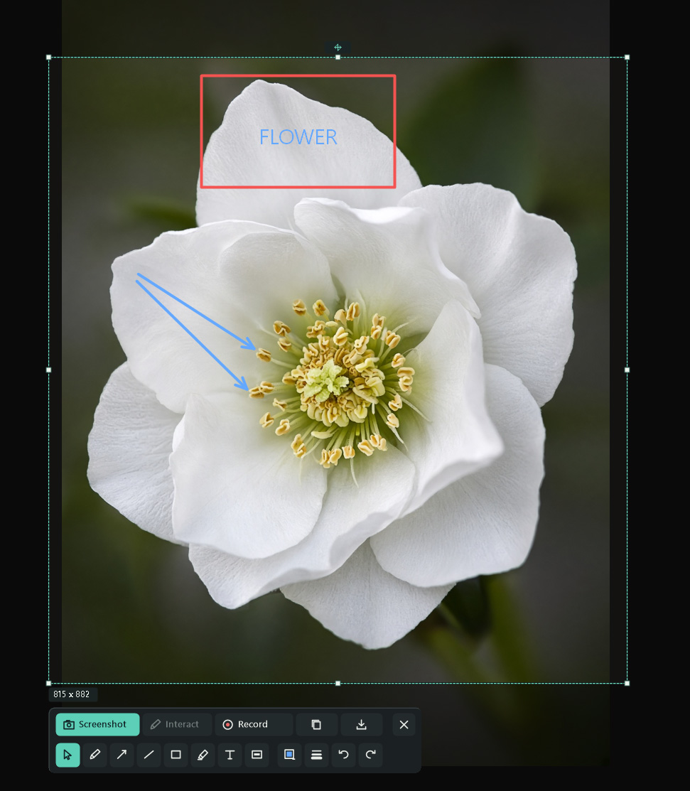
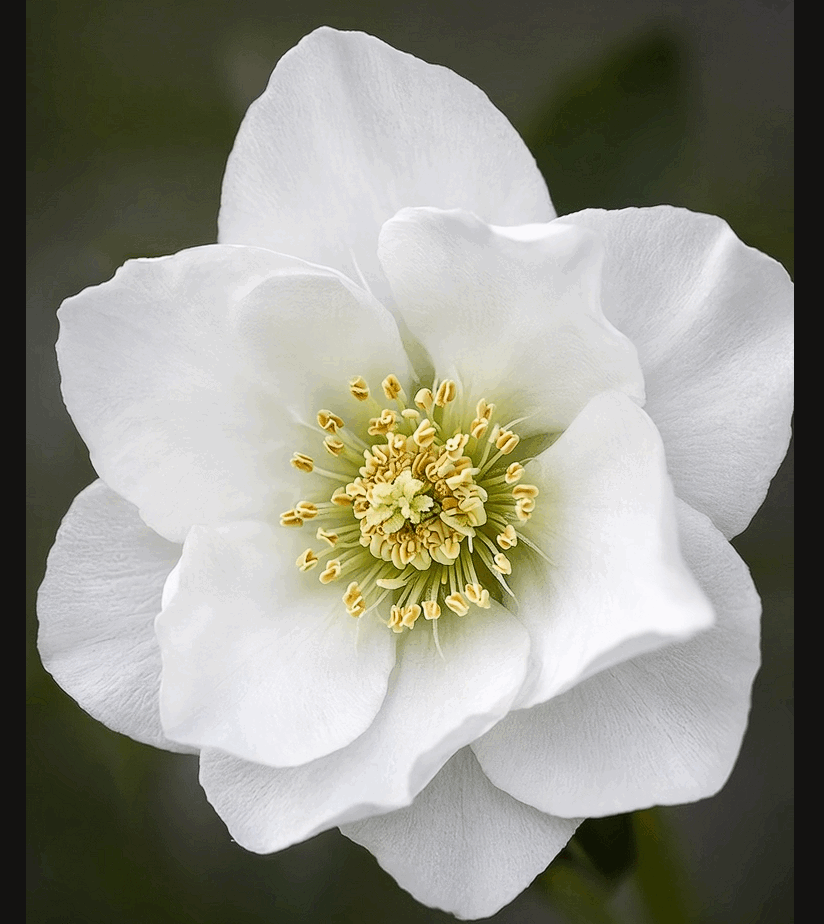

# Drawscr

**Capture, annotate, share.**

Drawscr is a portable Windows tool for quick screenshots, annotations and GIF recordings. Built with native Windows APIs, by [DZRobo&SI](https://dzrobo.com/).

<p align="center">
  
</p>

## Start here

1. **Get the portable app:** open [portable/Drawscr.exe](portable/Drawscr.exe). On GitHub, use **Download raw file**, then run the downloaded EXE. Windows 10 or 11, 64-bit, is required; there is no installer.
2. Press **Print Screen**, or choose a capture action from the launcher or tray. Drag to select an area; move the frame or resize it with its handles.
3. Annotate, then press **Ctrl+C** to copy or **Ctrl+S** to save. A successful copy or save closes the capture.

Settings lets you choose a keyboard or mouse shortcut, a calm accent theme, and optional tray or Windows-startup behavior. Preferences are saved in `Drawscr.ini` beside the EXE; use a writable folder and move the INI with the app to keep them. If Print Screen conflicts with another tool, **Assign anyway** lets Drawscr attempt to intercept it while running; another app can still take the key first. Drawscr does not change the Windows snipping setting.

## Capture and annotate

- **Screenshot** freezes the desktop; **Live** draws over it. Live's **Interact** control gives input back to the app underneath, and **Draw** returns to annotation.
- Add pen, marker, lines, arrows, rectangles and text; choose color and width, move objects, and undo or redo. Text size is remembered. Solid redaction uses the selected color and is flattened into the exported pixels.
- Copy the selected area or save it as PNG or JPEG. JPEG is encoded at quality 100 and remains lossy. Drawscr has no cloud upload.

## Record a GIF

Select and adjust the area, choose **Record**, stop when ready, then preview and save or discard. The GIF uses the selected pixel dimensions. Strong, Normal and Quality combine palette choices with bounded temporal color stability; frame rate is available under **More**. The encoder compares opaque, transparent and compact-palette frame representations and chooses the smaller result. Temporal optimization keeps the selected dimensions and timing, protects coherent thin features, and is bypassed for sources with at most 256 exact colors. It is still lossy: subtle texture changes are possible, especially in Strong mode, and size savings depend on the recording.

<p align="center">
  
</p>

*Example GIF: about 18 MB, 8.4 seconds.*

GIF supports at most 256 colors, so gradients can lose detail. Recordings have no fixed time limit but use bounded memory and local temporary storage; recording stops if space becomes low. A frame is limited to 8192 pixels per side and 64 MiB. An unexpected termination can leave temporary files containing captured pixels. Live capture and recording require Windows support for excluding Drawscr windows from capture. Text editing is unavailable during an active recording.

## Capture responsiveness

Drawscr warms its UI fonts using a small private offscreen bitmap at launch and performs one compositor synchronization before capture. If capture initialization takes at least one second, it writes `Drawscr.ini.capture-timing.log` beside its settings file. This bounded diagnostic contains stage timings only, not screen pixels or document names.

## Build from source

Install Visual Studio 2022 C++ tools, a Windows SDK and CMake 3.23 or newer. From the repository root:

```powershell
cmake -S . -B build -G "Visual Studio 17 2022" -A x64
cmake --build build --config Release
```

The result is `build/Release/drawscr.exe`.

## License

[Drawscr License 1.0](LICENSE.txt) permits free personal and commercial use, and free standalone redistribution with attribution and the same terms. Selling the software or integrating it into another product requires prior written permission from Denis Rychkovskiy (DZRobo). Images and GIFs created with Drawscr are not restricted by this license. These custom terms are **source-available**, not an OSI open-source license.

Copyright (c) 2026 Denis Rychkovskiy (DZRobo). Project credit: by DZRobo&SI.
